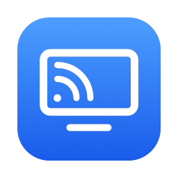

<p align="center">
  
</p>

<h1 align="center">Screen Cast</h1>

<p align="center">
  Show your Mac on a Chromecast, with sound and about a tenth of a second of delay.<br>
  Mirror your screen, or use the TV as a second display.
</p>

<p align="center">
  <a href="https://github.com/waqar3000/screen-cast-mac/releases/latest"></a>
  <a href="https://github.com/waqar3000/screen-cast-mac/actions/workflows/ci.yml"></a>
  
  <a href="LICENSE"></a>
</p>

---

Screen Cast is a free, open-source Mac app that sends your screen to a Chromecast using the same mirroring protocol Chrome uses for "Cast screen". It's a native app, so there's no browser tab to keep open and no account to sign in to.

- **Mirror** one of your Mac's screens.
- **Second display**: the TV becomes an extra monitor you can drag windows onto, at the resolution you choose.
- **Sound** from your Mac plays on the TV.
- **Low delay**: about 0.05–0.25 s, your choice. You can change it while casting.
- **Live connection stats**: delay, frame rate, bitrate, round trip, packet loss, and Wi-Fi speed and signal.

<p align="center">
  
</p>

## Requirements

- macOS 13 Ventura or later, on an Apple Silicon or Intel Mac
- A Google Chromecast, or a TV with Chromecast built in, on the same network as your Mac

So far it has been tested with a Chromecast on macOS 15 (Intel MacBook Pro). Other Cast devices that Chrome can mirror to should work too. If you try one, please [say how it went](https://github.com/waqar3000/screen-cast-mac/issues).

## Install

1. Download **ScreenCast-x.y.z.zip** from the [latest release](https://github.com/waqar3000/screen-cast-mac/releases/latest) and unzip it.
2. Drag **Screen Cast** to your Applications folder.
3. Open it. The app isn't notarized by Apple (that needs a paid developer account), so macOS will block it the first time:
   - **macOS 15 and later:** click **Done**, open **System Settings › Privacy & Security**, scroll down and click **Open Anyway** next to Screen Cast, then confirm.
   - **macOS 13–14:** Control-click the app, choose **Open**, then click **Open**.

You can also [build it yourself](#build-from-source), which takes about a minute.

### Permissions

The first time you cast, macOS asks for two permissions:

| Permission | Why |
|---|---|
| **Local Network** | To find your Chromecast and stream to it. |
| **Screen & System Audio Recording** | To capture your screen and the Mac's sound. After allowing it, quit and reopen Screen Cast. |

## Using it

1. Pick your **TV**.
2. Choose **Use TV as**: **Mirror** or **Second display**.
3. For a second display, pick a **Resolution**. *Larger text (1280 × 720)* is easiest to read from the sofa; *More space (1920 × 1080)* fits the most. You can switch while casting, and the same sizes appear in **System Settings › Displays**, where you can also arrange the TV next to your Mac's screen.
4. Pick a **Delay** (see below), and whether to **play sound on the TV**.
5. Click **Start Casting**.

Stopping removes the second display, and any windows on it move back to your Mac.

### Delay

The TV waits a moment before showing each frame. That gives Wi-Fi time to resend anything it drops. A shorter delay feels snappier, and a longer one rides out a busy network.

| Setting | Delay | Good for |
|---|---|---|
| Lowest | 0.05 s | Fast, quiet Wi-Fi close to the router |
| Low (default) | 0.1 s | Most homes |
| Smoothest | 0.25 s | Busy or distant Wi-Fi |

If the picture stutters or the connection panel shows late frames, choose a longer delay. A TV's own image processing can add delay too; turning on its **Game mode** helps.

### The connection panel

While casting, the panel shows how the stream is doing, mostly as the TV reports it:

| | |
|---|---|
| **Connection** | Excellent, Good or Poor, based on lost packets, late frames and the round trip. |
| **Delay** | How long the TV waits before showing each frame. |
| **Frame rate** | Screen updates sent per second (up to 60). Only changes are sent, so this drops when nothing moves. |
| **Resolution**, **Bitrate** | The video being sent. |
| **Mac processing** | Time to capture, encode and send a frame. The delay needs to be longer than this plus the round trip. |
| **Round trip** | Time for a message to reach the TV and come back. |
| **Packet loss**, **Late frames** | Packets the TV missed the first time, and frames it showed late. |
| **Wi-Fi speed**, **Wi-Fi signal** | Your Mac's link to the router. |

## Build from source

You need Xcode 15 or later.

```bash
git clone https://github.com/waqar3000/screen-cast-mac.git
cd screen-cast-mac
./build.sh --open
```

`build.sh` puts the app in `build/Screen Cast.app`. Use `--universal` to build for both Apple Silicon and Intel, or `--release` to also make a zip. To work on the code, open `Package.swift` in Xcode, and see [CONTRIBUTING.md](CONTRIBUTING.md).

## How it works

Chromecasts include a receiver app for Chrome's screen mirroring, which speaks a protocol called *Cast Streaming*. Screen Cast is an independent implementation of the sending side:

1. **Capture**: ScreenCaptureKit captures a display and the Mac's sound. For a second display, the app first creates a virtual monitor.
2. **Encode**: the Mac's hardware H.264 encoder compresses the video; audio becomes Opus.
3. **Send**: each frame is encrypted and sent to the TV over UDP. The app resends anything the TV reports missing, and sends a fresh full frame when the TV asks or the screen settles.

[docs/HOW_IT_WORKS.md](docs/HOW_IT_WORKS.md) explains the architecture and the protocol in detail.

## Privacy

Screen Cast has no accounts, analytics or servers. Your screen and sound go only to the Chromecast you pick, over your local network, encrypted the same way Chrome encrypts them. The app saves a few preferences on your Mac (last TV, mode, resolution and delay). Its diagnostic log stays in the system log on your Mac.

## Limitations

- **Second display uses an undocumented macOS API** (`CGVirtualDisplay`, the same one Chromium's tests use). A future macOS update could break it. Mirror mode uses only public APIs.
- **Video is H.264, up to 1920 × 1080 at 60 fps**, the most every Chromecast can decode.
- **The app isn't notarized**, so macOS asks you to confirm the first time you open it (see [Install](#install)).
- **Some networks block it.** Guest networks and some mesh or corporate Wi-Fi isolate devices from each other, which stops the stream.
- **Sound plays on both** the Mac and the TV.

## Troubleshooting

<details>
<summary><b>No TVs appear</b></summary>

Make sure the Mac and the Chromecast are on the same network, and that Screen Cast is allowed in **System Settings › Privacy & Security › Local Network**.
</details>

<details>
<summary><b>"Screen Cast needs permission to record your screen", even though it's allowed</b></summary>

Quit and reopen the app; macOS only applies this permission after a restart. If that doesn't help, the permission may belong to an older copy of the app. Remove it by running this in Terminal, then allow it again:

```bash
tccutil reset ScreenCapture io.github.waqar3000.ScreenCast
```
</details>

<details>
<summary><b>"The TV refused the stream: it stopped responding"</b></summary>

The TV's replies come back over UDP. Check that the macOS firewall allows incoming connections for Screen Cast, and that your Wi-Fi doesn't isolate devices (common on guest networks).
</details>

<details>
<summary><b>The picture stutters or freezes briefly</b></summary>

Choose a longer **Delay**, or move the Mac closer to the router. The connection panel shows whether packets are being lost or frames are arriving late.
</details>

<details>
<summary><b>Diagnostic logs</b></summary>

The app logs the connection with the TV and, every second, the TV's playback statistics:

```bash
log show --last 10m --predicate 'process == "ScreenCast" AND eventMessage BEGINSWITH "["'
```

To check the connection without capturing the screen, cast a test card (a running clock with a beep each second) for 20 seconds:

```bash
open "/Applications/Screen Cast.app" --args --test-cast 20
```
</details>

## Contributing

Bug reports, device reports and pull requests are welcome. See [CONTRIBUTING.md](CONTRIBUTING.md). To report a security issue privately, see [SECURITY.md](SECURITY.md).

## License and trademarks

Screen Cast is released under the [MIT License](LICENSE). Portions are adapted from Chromium under its BSD-style license; see [THIRD_PARTY_NOTICES.md](THIRD_PARTY_NOTICES.md).

Google, Chromecast and Google Cast are trademarks of Google LLC. Apple, Mac and macOS are trademarks of Apple Inc. Screen Cast is an independent project. It isn't affiliated with, sponsored by or endorsed by Google or Apple.
